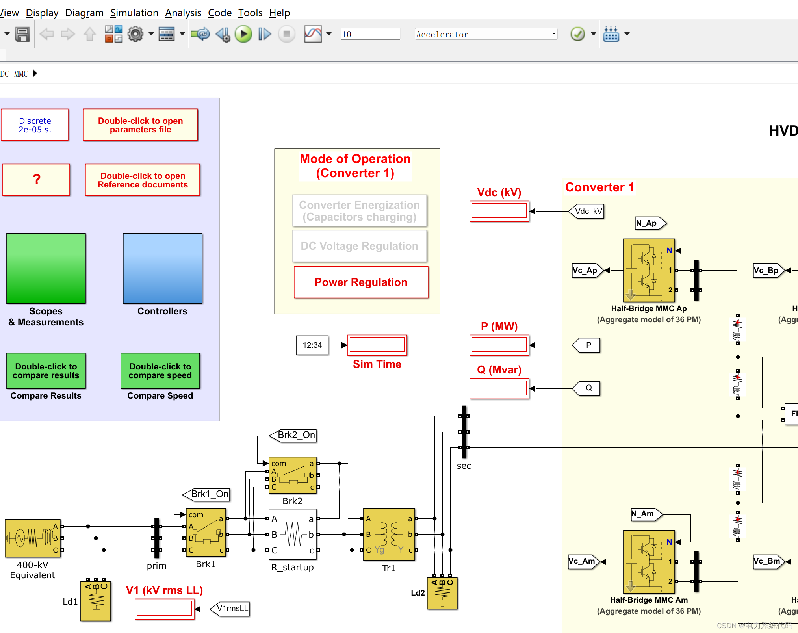
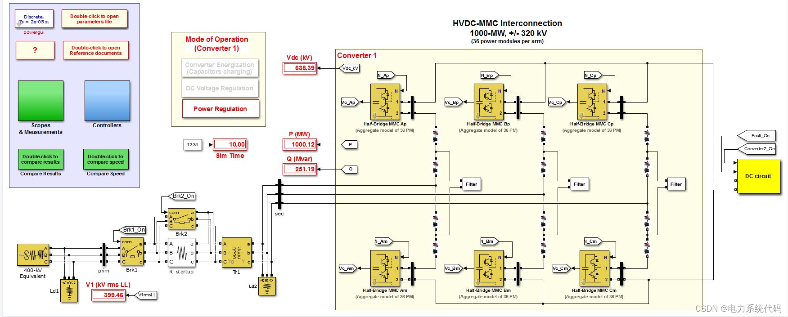
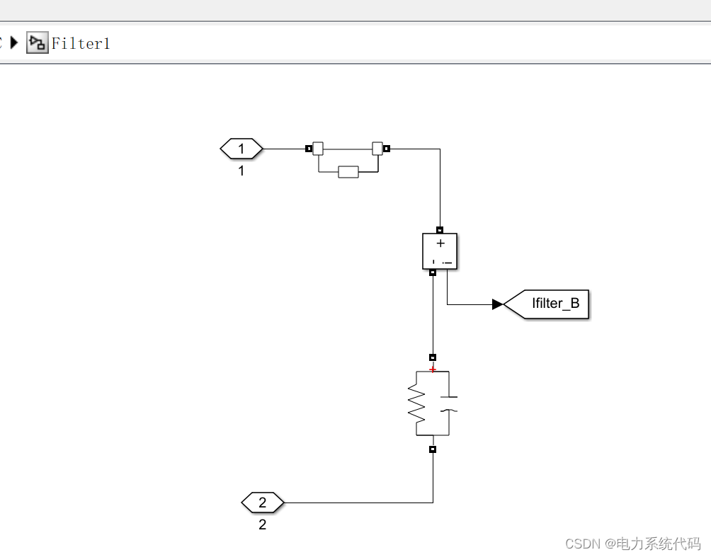
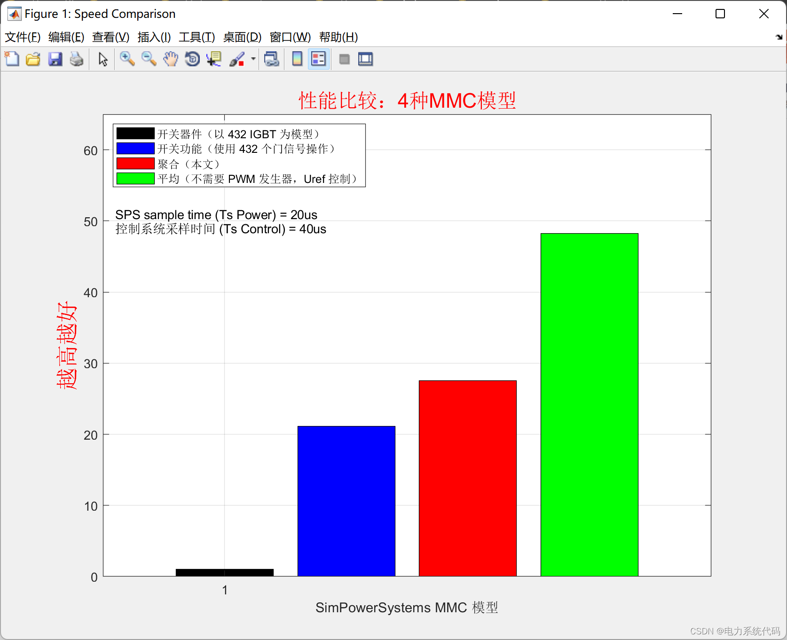
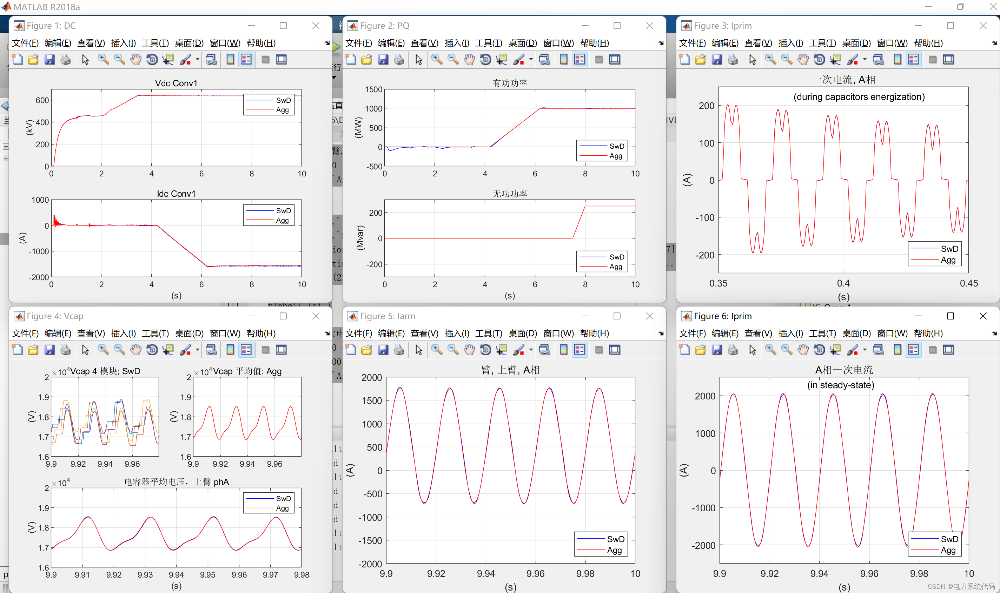

# SimPowerS for High Voltage Direct Current (HVDC) Interconnections of Voltage Source Converters (VSC) Based on Modular Multilevel Converter (MMC) Technology

SimPowerSystems (SPS) model of high voltage direct current (HVDC) interconnection based on modular multilevel converter (MMC) technology (Matlab&Simulink implementation)
​  
1 Overview of the SPS model for the HVDC-MMC interconnection of 1000 MW. This paper presents a SimPowerSystems (SPS) model for the high voltage direct current (HVDC) interconnection of MMC-based voltage source converters (VSC). The SPS simulation has been optimized using an aggregated MMC model.
Direct current (DC) transmission lines are increasingly becoming the preferred method for power exchange between countries and for the delivery of renewable energy to the grid, including hydropower plants, offshore wind farms, and solar power plants. Some systems are currently in operation, such as the Dolwin1 project (offshore wind HVDC link), or are planned for future projects, such as Northern Pass (Canada-US 1090-MW DC link).
This case study will illustrate a typical VSC topology currently in use: the Modular Multilevel Converter (MMC) technology. In this example, the MMC converter is implemented using an aggregated model to simulate each arm with 36 power modules. This aggregated model can effectively describe the dynamics of the control system, harmonics of the converter, and phenomena of repetitive currents. However, only one virtual capacitor is used to represent the 36 capacitors of the arm. The model assumes that the voltage across all power modules' capacitors is balanced. The operation speed of the aggregated model is much faster than that of the detailed model, which would require two switch devices and a capacitor for each individual power module. This aggregated model is also very suitable for real-time simulation.
Simulate the SPS model for 10 seconds, and observe the interconnection operations during startup (capacitor charging), voltage regulation, and power regulation. A comparison between this aggregated model and the detailed SPS model is also provided.
Editor
Editor
Editor
1. Preparation: Simulink SimPowerSystems Simscape2 Main Module Description
2.1 The power grid is used with equivalent voltages of 400 kV and 50 Hz, and two circuit breakers are supplied to the converter 1.
2.2 The converter 1 uses six half-bridge MMC modules for implementation, each representing 36 power supply modules. This custom SPS module utilizes a switch function model, where only one equivalent module is used to represent all power supply modules. The control signal is a binary vector [Nin, Nbl], where Nin represents the number of inserted modules and Nbl represents the number of modules in blocking state. The output Vc (capacitor voltage) has only one element and provides the average value of the capacitor module.
2.3 In the DC circuit subsystem, you will find a simplified model of cables and the second converter using DC power and ideal switch models. You will also find a switch for applying faults on the cables.
2.4 The controller subsystem contains various control systems required for interconnection operations. It includes the following subsystems: active and reactive power regulators - DC voltage regulator - dq current regulator with feedforward - PLL and measurement subsystem - PWM generator for controlling the converter 1 (Converter1 ) half-bridge MMC. In the folder, you can also find a sorting area for programming various operating modes of the converter 1.
2.5 Oscilloscope and Measurement This subsystem includes all oscilloscopes for observing multiple signals during simulation. Power and fundamental voltage calculations are also performed within this subsystem.
3 Simulink simulation and MATLAB code 3.1 Parameter setting for modeling SPS with a simulation duration of 10 seconds, allowing observation of interconnection operations during the start-up (capacitor charging), voltage regulation, and power regulation phases. All parameters required to run the model can be found in the subroutine HVDC_MMC_param.m. When the example is opened, it will automatically execute in the MATLAB workspace. Upon running the model, observe:
%HVDC_MMC_param.m:\n\n% This module is the SPS model parameter file: HVDC_MMC.slx\n\nload sound                     % Sound.mat used in the operation panel\n\nFnom= 50;                      % System Frequency (Hz)\nPnom= 1000e6;                  % Converter Three-Phase Rated Power (MVA)\nVnom_prim= 400e3;              % Normal rated voltage (V)\nVnom_sec= 333e3;               % Normal secondary voltage (V)\nNb_PM=36;                      % Number of arms power module\nVnom_dc= 640e3;                % Direct Current nominal voltage (V)\nC_PM= 1.758e-3; % Power module capacitor (F)\n%% Energy input kJ/MVA\nW_kJ_MVA= 0.5 * C_PM * (Vnom_dc/Nb_PM)^2 * Nb_PM * 6 / (Pnom/1e6)/1e3;\nVc0_PM=0;                     % Capacitor Initial Voltage (V)\n\n%% Sequencer Timing:\nTbrk1_On=0.1;                 % Circuit breaker 1 energization time (transformer charging amount)\nTbrk2_On=1.0;                 % Closing time of circuit breaker 2 (s) (cross-starting resistance)\n%===========================================================%\nTdeblock=1.5;                 % Converter unblocking time (s)\nTon_VDCreg=1.5;               % VDC regulating unit start time (s) - VDC regulating\nTramping_Vdc_ref=2;           % Start time Vdc_ref rises to nominal value (s)\nSlope_Vdc_ref=Vnom_dc/5;      % Climbing (V/s)\n%==========================================================%\nTon_PQreg=4;                  % Preg & Qreg regulating time (s) - PQ adjustment\nTramping_Pref=Ton_PQreg+0.2;  % Pre-slope start time (s)\nSlope_Pref=0.5;               % Climbing (V/s)\nTramping_Qref=Ton_PQreg+3.5;  % Pre-slope start time (s)\nSlope_Qref=0.5;               % Climbing (V/s)\n%==========================================================%\nTon_Converter2=4;             % Equivalent on-time (s) for converter 2\n%%\nTfault= 9999;             %DC fault sequence (s)\nRfault=1;                 %Direct Current Resistance (Ohms)\n\n%% PWM Output Pulse Selector\npp=0;\nfor p=1:2:72\n    pp=pp+1;\n    SelectPulses1(p)=pp;\n    SelectPulses1(p+1)=pp+36;\nend\n%====================================================%\nTs_Power= 20e-6;    % SPS simulation time step (s)\nTs_Control=40e-6;   % The control system time step (s)\nTs=Ts_Control;\n\n%% Transformer Impedance\nLxfo= 0.12;         % Total leakage (pu)\nRxfo= 0.003;        % Total winding resistance (pu)\n\nZbase= Vnom_sec^2/Pnom;\n\nLarm_pu=0.15;\nRarm_pu=Larm_pu/100;\n\nZbase= Vnom_sec^2/Pnom;\nLarm=Larm_pu*(Zbase/(2*pi*Fnom));\nRarm=Rarm_pu*Zbase;\nw=2*pi*Fnom;\nwc2=(2*w)^2;\nCfilter=1/(Larm*wc2);      % Capacitance value (F) of 2nd harmonic filter\nRfilter=1/(Cfilter*w)*30;  % The impedance of the 2nd harmonic filter (Ohms)\nTopen_Filter=1e6;          % The turn-on time of the disconnector for the second harmonic filter (s)\n\n%% Control parameters\n\n%======(1) Modulator parameters======\nFc=Fnom*3.37;        %Carrier Frequency (Hz)\n\n%======(2)dq and Vdc measurement filter cutoff frequency: ==\nFn_filter=1000;\nZeta_filter=1;\n\n%======(3) Active Power Regulator=======\nKp_Preg= 0.5/3;                % Proportional gain\nKi_Preg= 1.0;                  % Gain of integral\nLimits_Preg = [ 1.2, 0.8 ] ;   %Output Limit (pu)\n\n%======(4) Unbalanced Power Regulator======\nKp_Qreg= 0.5/3;                % Proportional gain\nKi_Qreg= 1.0;                  % Gain of integral\nLimits_Qreg = [ 0.25, -0.25 ]; % Output upper/lower limit (pu)\n\n%=====(5) DC Voltage Regulator==========\nKp_VDCreg=4;                   % Proportional Gain\nKi_VDCreg=100;                 % Gain of integral\nLimits_VDCreg= [ 2.0  -2.0];   % Output upper/lower limit (pu)\n\n%======(6) Current Regulator========\nKp_Ireg= 0.6;                  % Proportional gain\nKi_Ireg= 6;                    % Gain of integral\nLimits_Ireg= [ 2.0  -2.0];     % Output upper/lower limit (pu)\n\n%=====(7)Feedforward coefficients==========\nLff=Larm_pu/2;\nRff= Rarm_pu/2;\n\n%% Electric Power System Parameters\n\nPsc= Pnom*20;     % Short-circuit power (MVA)\nX_R= 7;           % X/R ratio\nP_Ld1= Psc/30;   % Load (main busbar) (MW)\nR_startup= 400;   % Starting Resistance (Ohm)\n\n%=========Cable Data========\nR_cable = 0.5;      % Ohm\nL_cable= 15e-3;   % (H)\n\n% Grounding (RC)\nRg= 100;              % Ohm\nCg= 50e-9;            % (F)\n\n\n\n  
At 0.1 seconds, breaker 1 is closed and converter 1 is energized through a resistor to reduce the charging current. The capacitor is charging and at 1 second, the resistor short-circuits through closing breaker 2. At 1.5 seconds, converter 1 is deblocked and the voltage regulator is enabled. At 2 seconds, the voltage regulator setpoint rises steeply to the nominal DC operating voltage of the interconnected system: 640 kV (+/-320 kV). At 4 seconds, the PQ stabilizer is enabled and breaker 2 switches on. At 4.2 seconds, the active power regulator setpoint rises steeply to 1pu (1000 MW).At 7.5 seconds, the setpoint for reactive power regulators rises to 0.25pu (250 Mvar). If the parameter "Tfault" is set to 7 (actual default value =9999) and the simulation is restarted in the working area, a DC fault will be applied between the cables at 7 seconds. The half-bridge MMC will be blocked, and interconnections will close after two cycles (Brk1 will open).
3.2 SPS comparison to compare the results of this model with a detailed SPS model containing 432 (2*36*6) IGBTs, double-click the comparison result subsystem. To compare the simulation speed of this model with other SPS MMC models, double-click the Compare Speed subsystem.
close all\n%\n% Ts_Power=20us & Ts_Control=40us\n%\n\nExecTime(1)=1351;   % SwD (s)\nExecTime(2)=64;    % SwF (s)\nExecTime(3)=49;     % Agg (s)\nExecTime(4)=28;     % Avg (s)\n%\nh1=figure;\nset(h1,'Name','Speed Comparison');\nScreenS=get(0,'Screensize');\nset(h1,'Position',[ScreenS(3)*0.2 ScreenS(4)*0.16 ScreenS(3)*0.58 ScreenS(4)*0.67])\nbar(1,1./(ExecTime(1)/max(ExecTime)),'k')\nhold on\nbar(2,1./(ExecTime(2)/max(ExecTime)),'b')\nbar(3,1./(ExecTime(3)/max(ExecTime)),'r')\nbar(4,1./(ExecTime(4)/max(ExecTime)),'g')\nylabel('Higher is better','Fontsize',18,'Color','r')\ntitle('Performance comparison: 4PlantMMCModel','Fontsize',16,'Color','r')\nlegend('Switching device (in) 432 IGBT For the model.)','Switch function (using) 432 Individual door signal operation)','Aggregation (this article))', 'Average (not needed) PWM Generator, Uref Control)','Location','NorthWest')\ngrid\naxis([0 5 0 65])\nxlabel('SimPowerSystems MMC Model')\ntext(0.1,51,'SPS sample time (Ts Power) = 20us')\ntext(0.1,49,'Control system sampling time (Ts Control) = 40us')\n  
Editor
3.3 Results Comparison: This article only displays a portion of the code; for the complete code, please refer to:
%.......\n\nh1=figure;\nset(h1,'Name','DC');\nScreenS=get(0,'Screensize');\nset(h1,'Position',[ScreenS(3)*0.01 ScreenS(4)*0.52 ScreenS(3)*0.32 ScreenS(4)*0.37])\nsubplot(2,1,1)\nplot(results.time3,results.signals(1).values*1e-3,'b', ...\nresults.time3,results.signals(11).values*1e-3,'r')\nylabel('(kV)')\ngrid\ntitle('Vdc Conv1')\naxis([0 10 0 700])\nlegend('SwD','Agg')\nsubplot(2,1,2)\nplot(results.time3,results.signals(2).values,'b', ...\nresults.time3,results.signals(12).values,'r')\nylabel('(A)')\nxlabel('(s)')\ngrid\ntitle('Idc Conv1')\nlegend('SwD','Agg')\naxis([0 10 -2000 1000])\n%\nh1=figure;\nset(h1,'Name','PQ');\nScreenS=get(0,'Screensize');\nset(h1,'Position',[ScreenS(3)*0.34 ScreenS(4)*0.52 ScreenS(3)*0.32 ScreenS(4)*0.37])\nsubplot(2,1,1)\nplot(results.time2,results.signals(3).values,'b', ...\nresults.time2,results.signals(13).values,'r')\nylabel('(MW)')\ngrid\ntitle('Active power')\naxis([0 10 -500 1500])\nlegend('SwD','Agg','Location','southeast')\nsubplot(2,1,2)\nplot(results.time2,results.signals(4).values,'b', ...\nresults.time2,results.signals(14).values,'r')\nylabel('(Mvar)')\nxlabel('(s)')\ngrid\ntitle('Reactive power')\naxis([0 10 -300 300])\nlegend('SwD','Agg','Location','southeast')\n%\n% \nh1=figure;\nset(h1,'Name','Iprim');\nScreenS=get(0,'Screensize');\nset(h1,'Position',[ScreenS(3)*0.67 ScreenS(4)*0.52 ScreenS(3)*0.32 ScreenS(4)*0.37])\nplot(results.time1(1:25000),results.signals(5).values(1:25000),'b')\nhold on\nplot(results.time1(1:25000),results.signals(15).values(1:25000),'r')\nylabel('(A)')\nxlabel('(s)')\ngrid\ntitle('One-time current, AOutput:')\naxis([0.35 0.45 -250 250])\ntext(0.38,225,'(during capacitors energization)')\nlegend('SwD','Agg','Location','southeast')\n%\nh1=figure;\nset(h1,'Name','Vcap');\nScreenS=get(0,'Screensize');\nset(h1,'Position',[ScreenS(3)*0.01 ScreenS(4)*0.06 ScreenS(3)*0.32 ScreenS(4)*0.37])\nsubplot(2,2,1)\nplot(results.time1(225000:250000),results.signals(6).values)\nylabel('(V)')\naxis([9.9 9.98 16000 20000])\ngrid\ntitle('Vcap 4 Module; SwD')\nsubplot(2,2,2)\nplot(results.time1(225000:250000),results.signals(16).values,'r')\naxis([9.9 9.98 16000 20000])\nylabel('(V)')\ngrid\ntitle('Vcap Mean: Agg')\nsubplot(2,2,[3:4])\nplot(results.time1(225000:250000),results.signals(7).values,'b', ...\nresults.time1(225000:250000),results.signals(17).values,'r')\nylabel('(V)')\naxis([9.9 9.98 16000 20000])\nxlabel('(s)')\ngrid\ntitle('Average voltage of capacitor, upper arm phA')\nlegend('SwD','Agg','Location','northeast')\n%\nh1=figure;\nset(h1,'Name','Iarm');\nScreenS=get(0,'Screensize');\nset(h1,'Position',[ScreenS(3)*0.34 ScreenS(4)*0.06 ScreenS(3)*0.32 ScreenS(4)*0.37])\nplot(results.time1(225000:250000),results.signals(8).values,'b', ...\nresults.time1(225000:250000),results.signals(18).values,'r')\nylabel('(A)')\nxlabel('(s)')\ngrid\ntitle('Arm, Upper arm, AOutput:')\naxis([9.9 10.0 -2000 2000])\nlegend('SwD','Agg','Location','southeast')\n%\nh1=figure;\nset(h1,'Name','Iprim');\nScreenS=get(0,'Screensize');\nset(h1,'Position',[ScreenS(3)*0.67 ScreenS(4)*0.06 ScreenS(3)*0.32 ScreenS(4)*0.37])\nplot(results.time1(225000:250000),results.signals(5).values(225000:250000),'b', ...\nresults.time1(225000:250000),results.signals(15).values(225000:250000),'r')\nylabel('(A)')\nxlabel('(s)')\ngrid\ntitle('APhase current')\naxis([9.9 10.0 -2500 2500])\ntext(9.935,2300,'(in steady-state)')\nlegend('SwD','Agg','Location','southeast')\n%  \n  
3.4 References [1] VSC-HVDC Transmission with Cascaded Two-Level Converters  
Bjorn Jacobson, Patrik Karlsson, Gunnar Asplund, Lennart Harnefors, Tomas Jonsson  
ABB, Sweden  
CIGRE 2010 B4-110  
[2]Setup and Performance of the Real-Time Simulator used for Hardware-in-Loop-Tests of a  
VSC-Based HVDC scheme for Offshore Applications.  
O. Venjakob, S. Kubera, R. Hibberts-Caswell, P.A. Forsyth, T.L. Maguire  
Siemens, Germany & RTDS Technologies, Canada  
Paper submitted to the International Conference on Power Systems Transients (IPST2013) in  
Vancouver, Canada July 18-20, 2013.

## Images

<!-- PAYMENT_BLOCK -->

## Get this dataset

- Payment link (Stripe): [Buy now](https://buy.stripe.com/3cs8yP7sY87d0vu9AB)
- Payment QR code: 

<!-- /PAYMENT_BLOCK -->
